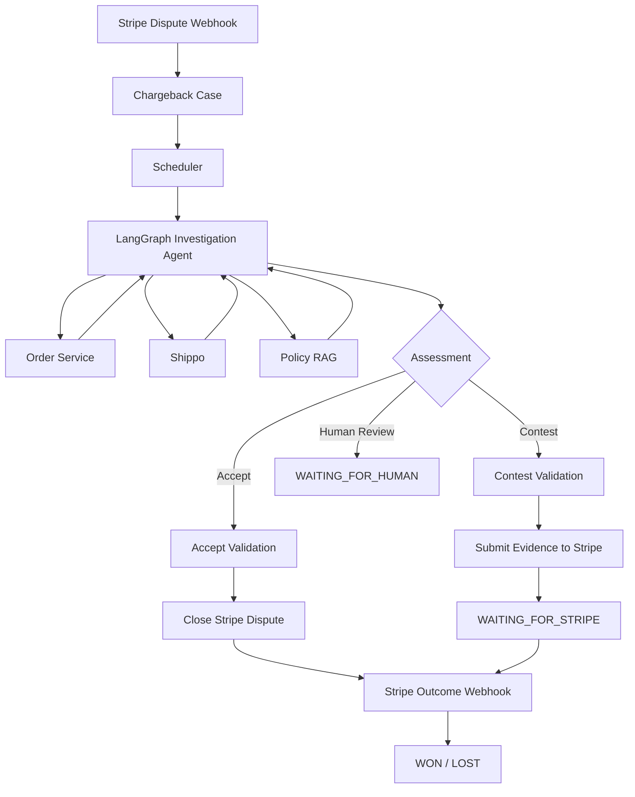

# Chargeback Resolution Agent

An AI agent for investigating and resolving merchant chargeback disputes.

The system receives Stripe dispute events, gathers evidence from operational systems, retrieves relevant company policy through RAG, and uses a LangGraph agent to recommend whether a dispute should be contested or accepted.

The key design principle is simple: **the agent reasons about evidence, while deterministic application code controls financial actions, state transitions, deadlines, and data integrity.**

## What It Does

For each chargeback, the system can:

- create and persist a Case from a Stripe dispute webhook;
- link the dispute to the corresponding merchant order;
- retrieve live order and refund information;
- retrieve shipment evidence from Shippo;
- search company chargeback policy through semantic retrieval;
- let the agent investigate the available evidence;
- produce a structured decision with confidence and reasoning;
- validate the proposed action before any external operation;
- submit contest evidence to Stripe or accept the dispute;
- receive Stripe outcome webhooks and persist the final result;
- process multiple open Cases concurrently.

## Architecture



## Agent Responsibilities

The LangGraph agent is responsible for:

- investigating available evidence;
- deciding which information source to query;
- interpreting order, refund, and shipping facts;
- retrieving relevant policy;
- identifying unresolved information;
- producing a structured assessment.

The agent currently has access to three tools.

### `search_company_knowledge`

Searches approved company policy and long-lived dispute guidance using RAG.

The retrieval pipeline uses:

- `BAAI/bge-small-en-v1.5`
- 384-dimensional embeddings
- PostgreSQL
- pgvector
- cosine similarity retrieval

### `get_order_details`

Retrieves live order information from the Order Management Service, including:

- fulfillment status;
- payment linkage;
- refund status and amount;
- shipping information;
- replacement-order information.

### `get_tracking_details`

Retrieves live shipment information from Shippo, including:

- current tracking status;
- tracking history;
- delivery timing;
- shipment events;
- available location information.

Stripe mutation operations are deliberately **not exposed as LLM tools**.

## Deterministic Workflow Control

The application retains control over operations that should not depend on unconstrained model behavior.

Deterministic code handles:

- Case and Stripe identifiers;
- database persistence;
- workflow transitions;
- evidence deadlines;
- Stripe dispute state;
- validation before financial actions;
- Stripe evidence submission;
- dispute acceptance;
- concurrency protection;
- final outcome persistence.

For example, an agent recommendation to contest does not immediately submit evidence.

```text
Agent recommends contest
        ↓
Evidence package prepared
        ↓
Deterministic validation
        ↓
Stripe submission
```

The validation layer checks that required state and evidence are present before an external action is allowed.

## Decision Model

The agent returns a structured assessment containing:

```text
decision
confidence
reasoning_summary
```

Supported decisions are:

```text
recommend_contest
recommend_accept
needs_human_review
continue_investigation
```

### Contest Path

```text
Investigation
    ↓
recommend_contest
    ↓
Prepare evidence
    ↓
Validate
    ↓
Submit to Stripe
    ↓
WAITING_FOR_STRIPE
    ↓
Stripe webhook
    ↓
WON / LOST
```

### Accept Path

```text
Investigation
    ↓
recommend_accept
    ↓
Validate
    ↓
Close Stripe dispute
    ↓
Stripe webhook
    ↓
LOST
```

Stripe remains the source of truth for the final external dispute outcome.

## Concurrency

The current implementation includes a two-worker scheduler using Python's `ThreadPoolExecutor`.

Eligible open Cases are selected from PostgreSQL in FIFO order and submitted to homogeneous workers running the same LangGraph workflow.

```text
Scheduler
   ├── Worker 1 → Case A
   └── Worker 2 → Case B
```

Because concurrent agents share the same Gemini API quota, the application also uses a **process-level shared rate limiter** rather than giving each worker an independent limiter.

During testing, the initial concurrent implementation exceeded the provider's request-per-minute limit. The shared limiter was introduced to coordinate requests across workers, after which concurrent Case processing completed successfully.

## Race-Condition Protection

Stripe can return an outcome webhook while the local workflow is still completing.

Without protection, a late workflow write could overwrite a newer terminal state such as `WON` or `LOST`.

The contest workflow therefore uses an atomic compare-and-update transition:

```text
GATHERING_EVIDENCE
        ↓
WAITING_FOR_STRIPE
```

The update succeeds only if the Case is still in the expected previous state.

This prevents stale workflow execution from overwriting a newer Stripe event.

## End-to-End Validation

The system has been exercised against Stripe test mode through both automated resolution paths.

### Contest

A Case with evidence supporting a contest was processed through:

```text
Stripe dispute
→ investigation
→ recommend_contest
→ evidence preparation
→ validation
→ Stripe evidence submission
→ WAITING_FOR_STRIPE
```

A complete contest lifecycle was also exercised through a Stripe test outcome ending in:

```text
WON
```

### Accept

A Case in which the merchant had already refunded the payment was processed through:

```text
Stripe dispute
→ investigation
→ recommend_accept
→ validation
→ Stripe dispute closure
→ outcome webhook
→ LOST
```

### Concurrent Processing

Two Cases were processed in the same scheduler run:

```text
Case A → recommend_accept → LOST
Case B → recommend_contest → WAITING_FOR_STRIPE
```

## Tech Stack

### Agent & Backend

- Python 3.12
- LangGraph
- FastAPI
- SQLAlchemy
- Pydantic
- Alembic

### LLM

- Google Gemini
- Ollama-compatible local models

### Retrieval

- BAAI/bge-small-en-v1.5
- PostgreSQL
- pgvector

### Integrations

- Stripe
- Shippo
- REST-based Order Management Service

### Infrastructure

- Docker Compose
- PostgreSQL 17
- Python `ThreadPoolExecutor`

## Local Setup

### Install dependencies

```bash
pip install -e .
```

### Configure environment

Copy `.env.example` to `.env` and provide the required test credentials.

### Start PostgreSQL

```bash
docker compose up -d
```

### Apply migrations

```bash
alembic upgrade head
```

### Start the Order Service

```bash
uvicorn services.order_service.main:app --port 8001
```

### Start the main API

```bash
uvicorn app.main:app --reload
```

### Forward Stripe webhooks

Using the Stripe CLI, forward Stripe test events to:

```text
http://localhost:8000/webhooks/stripe
```

### Run the scheduler

```bash
python scripts/test_scheduler.py
```

## Current Scope and Future Improvements

The current implementation demonstrates the complete automated accept and contest paths while keeping the orchestration intentionally small.

Areas for further development include:

- production-grade event queues and workers;
- durable suspend/resume for long-running workflows;
- per-Case retry and failure recovery;
- additional investigation sources such as customer communications;
- a production-ready human-review handoff;
- improved handling when automated investigation sources are exhausted;
- observability and monitoring;
- broader dispute reasons and evidence strategies;
- larger-scale concurrency and distributed rate limiting.